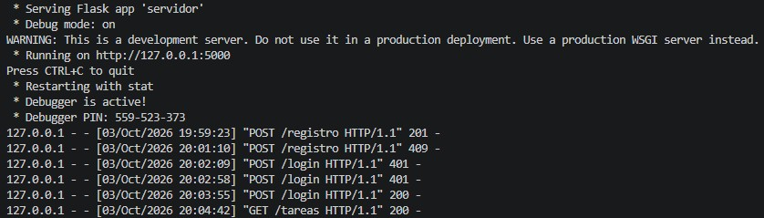
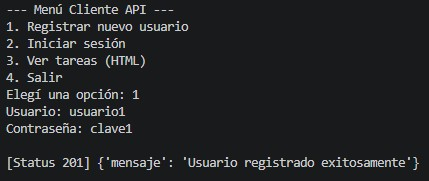
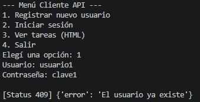
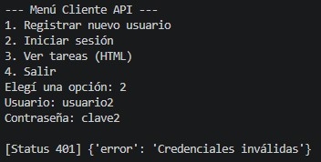
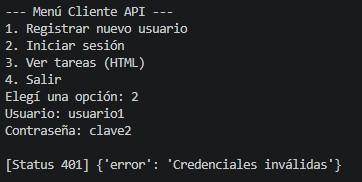
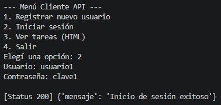
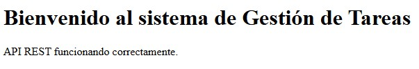

# Trabajo Práctico: PFO 2 - Sistema de Gestión de Tareas (API REST)

Este repositorio contiene la entrega de la PFO 2. Es una API REST armada con Flask y SQLite que maneja el registro y login de usuarios hasheando las contraseñas.

## Instalación y ejecución
Se requiere Python 3 instalado.

1. Clonar el repositorio y acceder a la carpeta del proyecto.
2. (Recomendado) Crear y activar un entorno virtual para no afectar la instalación global de Python:
   ```bash
   python -m venv venv
   # En Windows:
   venv\Scripts\activate
   # En Linux/Mac:
   source venv/bin/activate
   ```
3. Instalar las dependencias necesarias leyendo el archivo adjunto:
   ```bash
   pip install -r requirements.txt
   ```
4. Levantar el servidor:
   ```bash
   python servidor.py
   ```
   *(La API queda escuchando en `http://localhost:5000` y el archivo `tareas.db` se crea solo al iniciar la primera ejecución).*
5. Para probar los endpoints interactuando con la API, abrir otra terminal y ejecutar:
   ```bash
   python cliente.py
   ```

## Endpoints desarrollados
- **POST /registro**: Recibe `{"usuario": "...", "contraseña": "..."}` y guarda el usuario en la base de datos.
- **POST /login**: Verifica las credenciales.
- **GET /tareas**: Devuelve una vista HTML estática.

---

## Pruebas de funcionamiento

Capturas de pantalla con los distintos códigos de estado HTTP durante las pruebas del sistema.

### 1. Ejecución del Servidor


<br>

### 2. Registro de Usuarios (POST /registro)
**Registro exitoso (Status 201):**
<br>


<br>

**Manejo de error - El usuario ya existe (Status 409):**
<br>


<br>

### 3. Login (POST /login)
**Error - El usuario no existe (Status 401):**
<br>


<br>

**Error - Contraseña incorrecta (Status 401):**
<br>


<br>

**Login exitoso (Status 200):**
<br>


<br>

### 4. Acceso GET (/tareas)
**HTML renderizado en el navegador:**
<br>


<br>

---

## Respuestas Conceptuales

- **¿Por qué hashear contraseñas?**
  Básicamente por seguridad. Si guardamos las contraseñas en texto plano y alguien roba el archivo de la base de datos, tiene acceso a las claves reales de todos. Al pasarlas por una función de hash unidireccional, en la base solo queda una cadena ilegible que no se puede revertir para obtener la clave original.

- **Ventajas de usar SQLite en este proyecto:**
  Es ideal para este tipo de prácticas porque es un motor embebido. No hace falta instalar ni levantar un servicio complejo en la computadora (como pasaría con MySQL o SQL Server). Toda la base de datos queda guardada en un solo archivo físico (`tareas.db`), lo que hace que el proyecto sea mucho más ágil para trasladarlo y ejecutarlo en otro entorno.